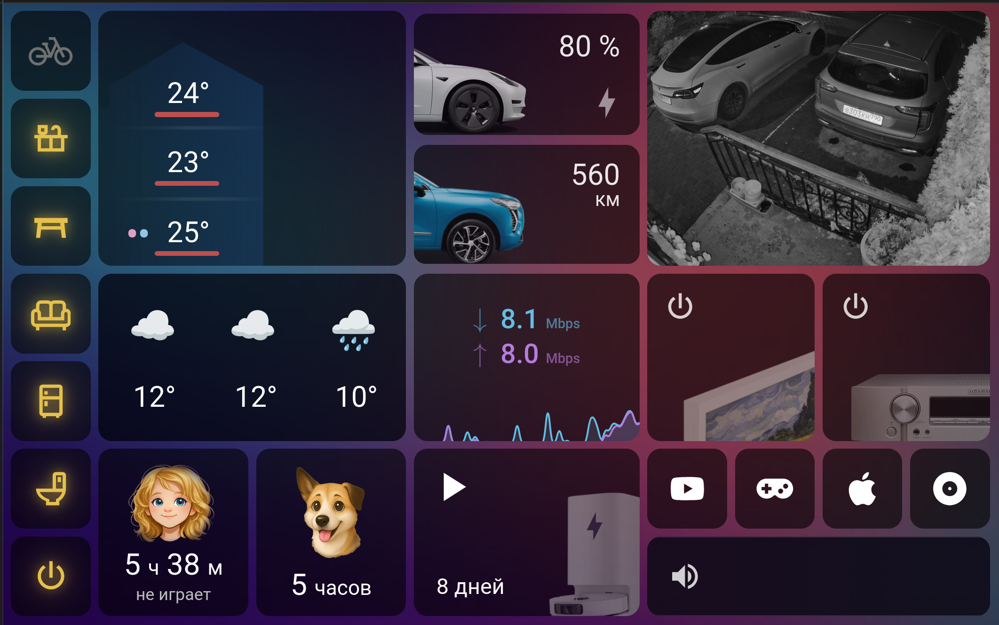
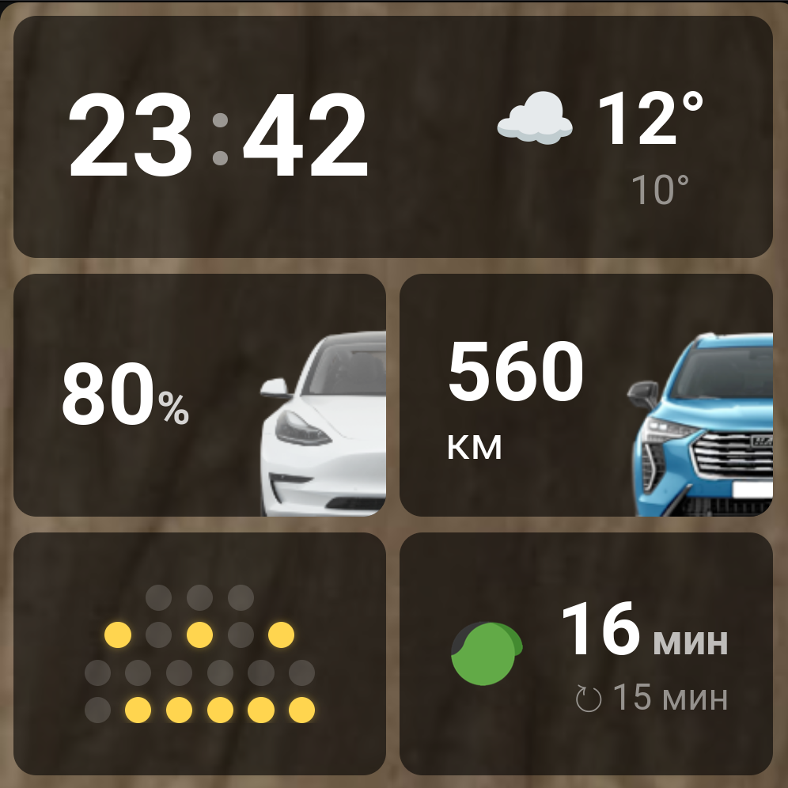

# Home Assistant house dashboards

A set of working, YAML-based Home Assistant dashboards built for two Amazon Fire HD Plus tablets and a Sonoff NSPanel. The tablets are convenient as permanent dashboards because they support wireless charging. This repository is for Home Assistant users and developers who want examples of a compact, touch-friendly home interface: how to compose reusable cards, connect them to live entities, and turn status displays into useful controls.

This is the dashboard layer of one real home, shared as reference code rather than a ready-to-install theme. The entity IDs, automations, camera endpoints, artwork, and screen dimensions reflect that home. You can reuse the patterns while replacing those details with your own.

## Screenshots

**Tablet 1st on Amazon Fire HD Plus**



**Sonoff NSPanel**



## What is here

| Path | Purpose |
| --- | --- |
| `tablet_1st.yaml` | Main dashboard for the first-floor tablet. |
| `tablet_2nd.yaml` | Second-floor variant with shared cards and a different arrangement. |
| `tablet_nspanel.yaml` | Compact Sonoff NSPanel layout, including a full-screen doorbell view. |
| `tablet/cards/{1st,2nd,nspanel}/` | The cards placed on each screen. Each YAML file contributes one or more cards. |
| `tablet/templates/` | Reusable `button-card` templates for styling and behavior. |
| `www/tablet/` | Backgrounds, vehicle and device artwork, and status icons. Home Assistant serves these as `/local/tablet/...`. |

The dashboard entry files define the screen layout and merge in the card templates with `!include_dir_merge_named` and the screen's cards with `!include_dir_merge_list`. A card's `view_layout.grid-area` assigns it to a named cell in the CSS grid. For example, both tablet layouts place the `main` temperature card, the `weather` card, and a camera card in the same areas, while the second-floor layout adds a fixed veranda camera.

Most visual components use `custom:button-card`. Its `template` property lets a card inherit shared styling (`base`, row heights, light states) and specialized behavior (`weather`, `camera`, `car`, `dog_feed`). Small JavaScript expressions inside `[[[ ... ]]]` read Home Assistant states, choose artwork and colors, format values, and decide what a tap should do. `custom_fields` combine several values or even nested cards into one tile. `card-mod` supplies the CSS that button-card styling alone cannot express.

## Examples worth exploring

- **House overview:** `tablet/templates/common/main.yaml` puts three floor temperatures over a house illustration. Heating and cooling change their colors; presence dots follow phone-derived floor sensors; blue drops appear beside floors inferred to be using water. The water inference itself is supplied by Home Assistant entities outside this repository.
- **Weather:** the large tablet widget renders current conditions and two later forecast slots. The NSPanel shows a clock, current weather, and the roughly six-hour forecast. Both read attributes of a custom `sensor.weather_forecast_extra` entity, so the forecast data must be provided separately.
- **Camera tile:** `tablet/templates/common/camera.yaml` shows the camera that last detected motion and lets a tap cycle through cameras. Camera images come through [simple-camproxy](https://github.com/spinogrizz/simple-camproxy), a separate project; its image URLs are used by the tablet camera tile and the NSPanel doorbell view. A Home Assistant automation writes the last camera ID to an `input_text` helper. The NSPanel replaces its normal grid with the doorbell image when `input_boolean.doorbell_on_dashboard` turns on.
- **One-tap corrections:** the dog card combines feeding timestamps and outside status; tapping it updates the relevant helper when the detected state is wrong. This is a useful pattern when camera or motion detection can miss an event.
- **Status and control together:** vehicle tiles display charge or fuel range and offer climate or engine actions; media tiles show the TV and receiver state and call a Home Assistant script for source presets. The script implementations are not in this repository.
- **Responsive to imperfect data:** vehicle range and charge tiles use a long dash for unavailable readings. The vacuum card hides its battery value when the integration cannot provide a valid number.
- **Other tiles:** room lights, a motion-aware room icon, Internet status and traffic graphs, a robot vacuum, travel time, and a gaming-session timer illustrate more ways to build small, glanceable controls.

## How the pieces connect

```text
Home Assistant integrations, helpers, templates, automations, scripts
                         │ entities and service calls
                         ▼
  tablet_*.yaml → card files → reusable button-card templates
                         │
                         ▼
              browser or wall-mounted screen
                         │
                         └── artwork from www/tablet/ via /local/tablet/
```

In Home Assistant, an **entity** is a named state such as `sensor.temperature_2nd_average` or `light.all_lights_2nd_floor`. A card reads an entity to display information. A **service call** changes something, such as turning off a light or calling `script.switch_receiver_input`. Helpers such as `input_boolean`, `input_text`, and `input_datetime` hold state used by the interface and its automations. This repository includes the frontend references to those entities, but does not provision the underlying devices or helpers.

## Adapting it to your Home Assistant instance

1. Install Home Assistant and the frontend cards used here: **button-card**, **layout-card** (for `custom:grid-layout` and `custom:layout-card`), **card-mod** (including `custom:mod-card`), **mini-graph-card**, and **slider-button-card**. Register their JavaScript resources in Home Assistant according to each card's installation instructions.
2. Copy `tablet_*.yaml`, `tablet/cards/`, `tablet/templates/`, and `www/tablet/` into your Home Assistant configuration directory, preserving their relative paths. Home Assistant maps `www/tablet/` to `/local/tablet/` in the browser.
3. Register each dashboard as a YAML dashboard. For example, add the following under the existing `lovelace:` section of `configuration.yaml` (merge with any dashboards you already have):

   ```yaml
   lovelace:
     dashboards:
       tablet-1st:
         mode: yaml
         title: Tablet 1st
         icon: mdi:tablet
         show_in_sidebar: true
         filename: tablet_1st.yaml
       tablet-2nd:
         mode: yaml
         title: Tablet 2nd
         icon: mdi:tablet
         show_in_sidebar: true
         filename: tablet_2nd.yaml
       tablet-nspanel:
         mode: yaml
         title: NSPanel
         icon: mdi:tablet
         show_in_sidebar: true
         filename: tablet_nspanel.yaml
   ```

4. Start with one card. Change its `entity` and any `states['...']` lookups to your entity IDs, then check its `tap_action` and `hold_action` service calls. The weather, media, camera, dog, and water examples also require their corresponding helpers, scripts, sensors, or automations. A missing entity can leave a tile blank or make its action fail.
5. Replace the hard-coded camera URLs and personal labels, and adjust the grid dimensions and background images for your device. The tablet grids use fixed pixel sizes for Amazon Fire HD Plus screens; the Sonoff NSPanel layout assumes approximately 480 × 480 pixels. This is a touch interface tailored to those screens, not a general responsive layout.

For a small first change, open `tablet/cards/1st/lights.yaml`, replace one `light.*` entity with a light you own, and choose an icon. The shared `light` template in `tablet/templates/light.yaml` handles the on/off appearance. From there, follow a `template:` name into `tablet/templates/` or a `grid-area:` name back to `tablet_1st.yaml` to see how a tile is assembled.

## Scope of the repository

Only dashboard YAML and the artwork it uses are tracked here. The home's `configuration.yaml`, `automations.yaml`, `scripts.yaml`, sensor definitions, integration setup, and secrets are intentionally absent. Some UI text is in Russian because this is an example from a lived-in home. Expect to adapt the language, entities, colors, images, and automations rather than paste these files unchanged into another installation.
